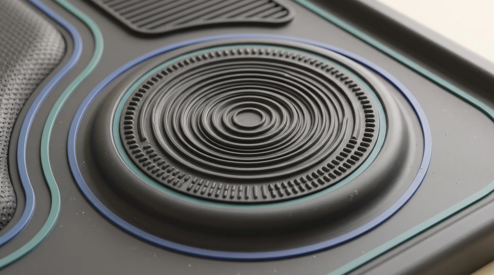
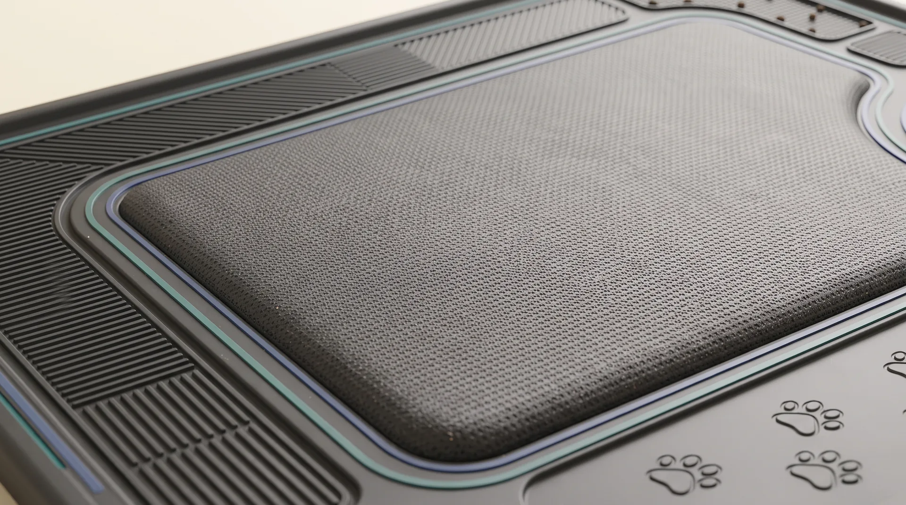
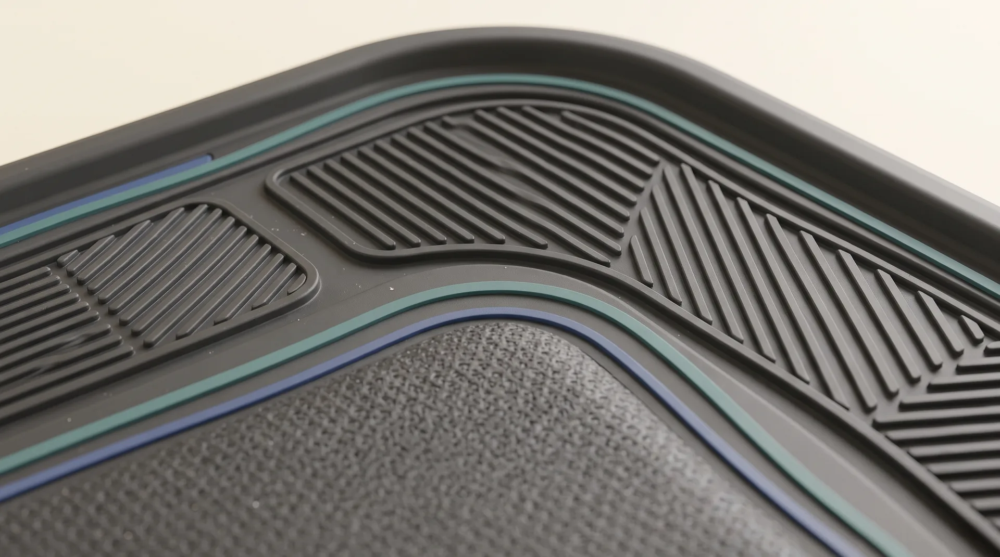
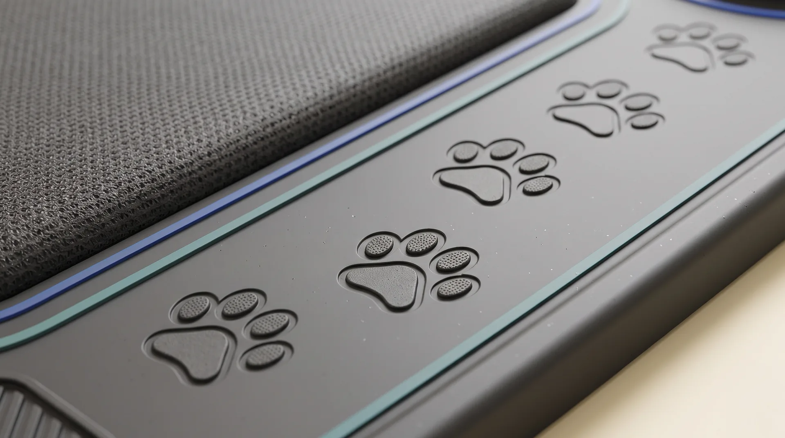
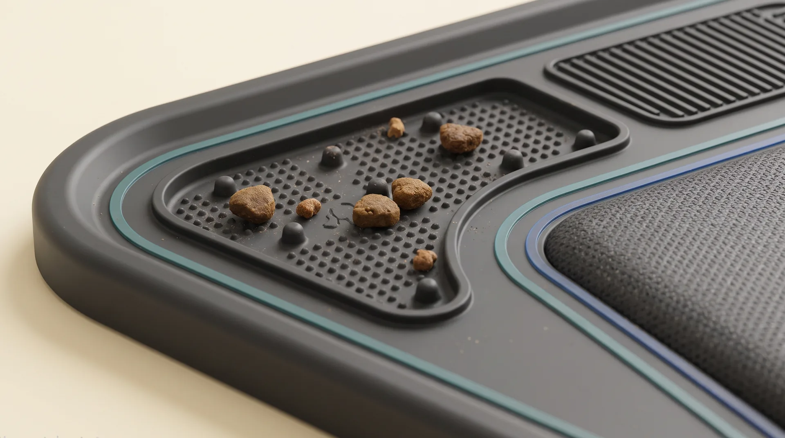
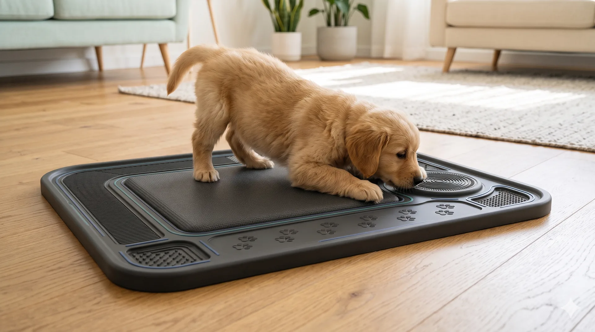
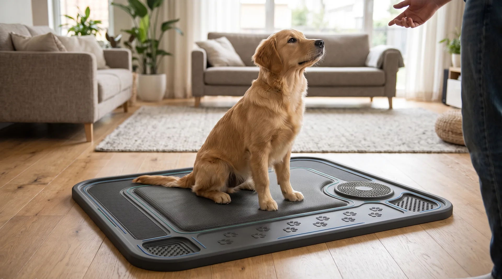
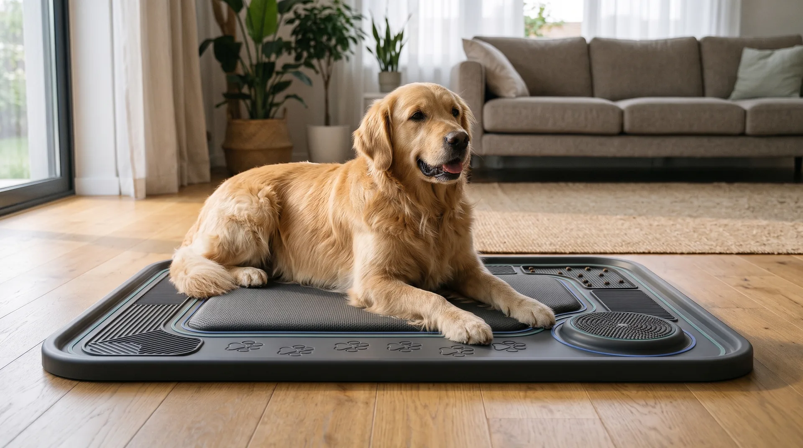

# PAWPATH

**Every pawstep learns something.**

PAWPATH is a premium e-commerce storefront for a single product: an all-in-one interactive dog-training mat with five permanently integrated learning zones.

Live site: https://41-hwa-hackathon.vercel.app

---


## The product

**The PAWPATH Interactive Training Mat** — ₹3,499 (was ₹4,299, saving ₹800)

A single-piece training mat, approximately 90 × 60 cm, that consolidates five different training activities into one integrated surface. No electricity, no batteries, no apps — physical, owner-guided learning built on tactile surfaces and positive reinforcement.

### The five zones

| Zone | Focus | Skills practised | Owner cue | Surface |
| --- | --- | --- | --- | --- |
| Target | Precision | Nose targeting, paw touch, directional focus | "Touch!" / "Paw!" | Tactile target |
| Place | Boundary | Boundary settle, door calm, impulse rest | "Place!" / "Settle!" | Cushioned sanctuary |
| Wait | Patience | Duration hold, threshold pause, release command | "Wait..." → "Free!" | Calibrated markers |
| Pathway | Guidance | Heel alignment, focused recall, direction changes | "Here!" / "Heel!" | Directional corridor |
| Reward | Reinforcement | Gentle food taking, dopamine pairing, calm completion | "Yes!" / marker | Reinforcement dock |











### How it works

1. **Choose a lesson** — pick a behaviour you want to practise.
2. **Give the cue** — use a familiar verbal command or hand signal.
3. **Make it rewarding** — guide your dog and reward the behaviour you want to reinforce.
4. **Repeat and progress** — practise regularly and build consistency.

### Learning stages



**Puppy — the first pawsteps** (8–16 weeks). Simple commands, touch interactions and getting comfortable with training. Skills: target touches, voluntary sit, short boundary rest.



**Learner — getting the hang of it** (4–12 months). Waiting, staying, following directions and responding to familiar cues. Skills: doorbell settle, step-back stays, pathway recall runway.



**Well-mannered — making it a habit** (1+ years). Reinforcing familiar commands, settling behaviours and everyday routines. Skills: dinner-table boundary, compound drills, mental enrichment.

### Construction and materials

| Property | Detail |
| --- | --- |
| Dimensions | Approximately 90 × 60 cm (35.4″ × 23.6″) |
| Construction | Single integrated component with beveled anti-curl perimeter |
| Material | Premium non-toxic food-grade silicone and natural vulcanized rubber |
| Surface | Multi-textured concentric ribs, grip nubs and directional corridors |
| Base | High-traction anti-slip anchor base, safe on hardwood, tile and carpets |
| Cleaning | Wipe clean with a damp cloth or rinse with mild soapy water; air-dries in 15 minutes |
| Power | No electricity or batteries required |
| In the box | 1× PAWPATH mat, 1× quick-start visual training guide, 1× roll-up storage strap |

---

## The website

A four-route storefront built around the product, with a slide-out cart instead of a cart page.

### Routes

| Route | Rendering | Purpose |
| --- | --- | --- |
| `/` | Static | Homepage — hero, brand story, interactive zone explorer, learning stages, method, FAQs, CTA |
| `/product/pawpath` | Static | Product page — asymmetric gallery, configurable price, quantity, zone exploration, benefits, training instructions, materials, technical specifications, FAQs, sticky purchase bar |
| `/checkout` | Static | Validated shipping form, simulated payment, order summary |
| `/order-confirmation` | Static | Order reference, delivery estimate, guarantee |
| `POST /api/orders` | Dynamic | Creates an order and returns a unique reference |
| `GET /api/orders?id=` | Dynamic | Looks up a stored order by reference |

### Commerce behaviour

- **Cart** — a small external store in `src/lib/cart.ts` persisted to `localStorage` and read through `useSyncExternalStore`, so the cart survives reloads and stays in sync across the header badge, the drawer and checkout.
- **Checkout** — React Hook Form with a Zod resolver. It collects full name, email, phone, house/flat, street/area, city, state, PIN code and country, plus a delivery method (standard or express) and a payment method. Field-level errors render inline, the submit button has a loading state, and failures surface a retryable banner.
- **Shipping** — standard delivery is ₹99, or free above ₹1,999; express delivery is ₹199. The order summary reflects the live selection.
- **Payment** — clearly marked **test mode**. Three simulated methods (UPI, card, cash on delivery) are selectable; no card data is collected, stored or sent. The form posts customer details, line items and totals to `/api/orders`, which simulates payment processing and returns a unique reference in the `PAW-XXXXXX-IN` format.
- **Order lookup** — the order is cached in `sessionStorage` at checkout and re-read on the confirmation page, with an API fallback and a demo order as the last resort.

### Design system

Tokens are defined once as CSS custom properties in `src/app/globals.css`.

| Token | Value | Role |
| --- | --- | --- |
| `--brand-forest` | `#0a3824` | Dark panels, primary action surfaces |
| `--brand-emerald` | `#065f46` | Headings and deep accent text |
| `--brand-green` | `#0da162` | Primary interactive accent |
| `--brand-green-hover` | `#0a844f` | Hover state for the green accent |
| `--brand-charcoal` | `#14241c` | Body copy |
| `--brand-muted` | `#536b5e` | Secondary copy |
| `--brand-ivory` | `#faf8f3` | Page background |
| `--brand-cream` | `#f6f3eb` | Alternate section background |
| `--brand-light-mint` | `#eaf5ed` | Soft panels |
| `--brand-soft-mint` | `#dcfce7` | Highlights |
| `--brand-coral` | `#ff6b6b` | Sparing accent, price savings |
| `--brand-border` | `#dbe7df` | Hairline borders |

Typography is **Plus Jakarta Sans** for headings and **Inter** for body copy, both loaded through `next/font/google`. Surfaces are large, generously rounded containers with asymmetric editorial layouts rather than repeated card grids.

---

## Tech stack

| Package | Version |
| --- | --- |
| next | 16.4.6 (App Router, Turbopack) |
| react / react-dom | 19.3.1 |
| typescript | 7.0.2 |
| tailwindcss | 4.3.5 |
| framer-motion | 14.14.0 |
| lucide-react | 1.77.0 |
| react-hook-form | 7.92.0 |
| zod | 4.6.7 |

---

## Folder structure

```
pawpath/
├── public/
│   └── images/products/          # Optimised WebP product imagery
│       ├── hero.webp             # Mat overview
│       ├── dog-hero.webp         # Hero lifestyle shot
│       ├── lifestyle.webp        # In-home lifestyle shot
│       ├── stage-puppy.webp
│       ├── stage-learner.webp
│       ├── stage-adult.webp
│       ├── zone-target.webp
│       ├── zone-place.webp
│       ├── zone-wait.webp
│       ├── zone-pathway.webp
│       └── zone-reward.webp
│
├── src/
│   ├── app/                      # App Router
│   │   ├── layout.tsx            # Fonts, metadata, Organization JSON-LD
│   │   ├── page.tsx              # Home
│   │   ├── globals.css           # Tailwind v4 theme tokens, keyframes
│   │   ├── favicon.ico
│   │   ├── robots.ts
│   │   ├── sitemap.ts
│   │   ├── product/pawpath/      # Product page + route metadata & JSON-LD
│   │   ├── checkout/             # Checkout page + route metadata
│   │   ├── order-confirmation/   # Confirmation page + copy-reference client
│   │   └── api/orders/route.ts   # POST create / GET lookup
│   │
│   ├── components/
│   │   ├── header.tsx            # Sticky nav, cart badge, mobile menu
│   │   ├── footer.tsx            # Editorial footer
│   │   ├── cart-drawer.tsx       # Slide-out cart drawer
│   │   ├── polished-image.tsx    # Image with graceful placeholder fallback
│   │   ├── zone-showcase.tsx     # Interactive zone explorer
│   │   ├── zone-diagram.tsx      # Radial five-zone diagram
│   │   └── ui/                   # button.tsx, card.tsx
│   │
│   └── lib/
│       ├── products.ts           # Central product config: copy, zones, stages, FAQs
│       ├── cart.ts               # Cart store and useCart hook
│       ├── validations.ts        # Zod checkout schema
│       └── utils.ts              # cn(), formatINR(), generateOrderReference()
│
├── next.config.ts
├── eslint.config.mjs
├── tsconfig.json
└── package.json
```

---

## Running locally

```bash
npm install
npm run dev        # dev server on http://localhost:3000
npm run build      # production build
npm run start      # serve the production build
npm run lint       # ESLint
```

Deploy:

```bash
vercel --prod
```

---

## Working with images

All product imagery lives in `public/images/products/` as WebP, generated from source photographs with `sharp`:

- Maximum edge 1920 px, quality 82 — the full set is roughly 2 MB.
- Rendered through `next/image`, so the browser receives a correctly sized, format-negotiated derivative rather than the original.
- `src/components/polished-image.tsx` handles the fallback: if a file is missing or fails to load, the slot renders a branded placeholder instead of breaking the layout.

To replace an image, drop a new `.webp` at the same path with the same dimensions. To change which file a slot uses, update the path in `src/lib/products.ts`.
