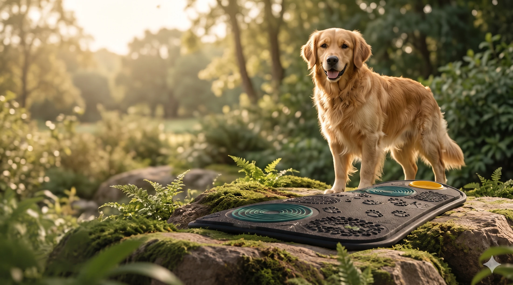
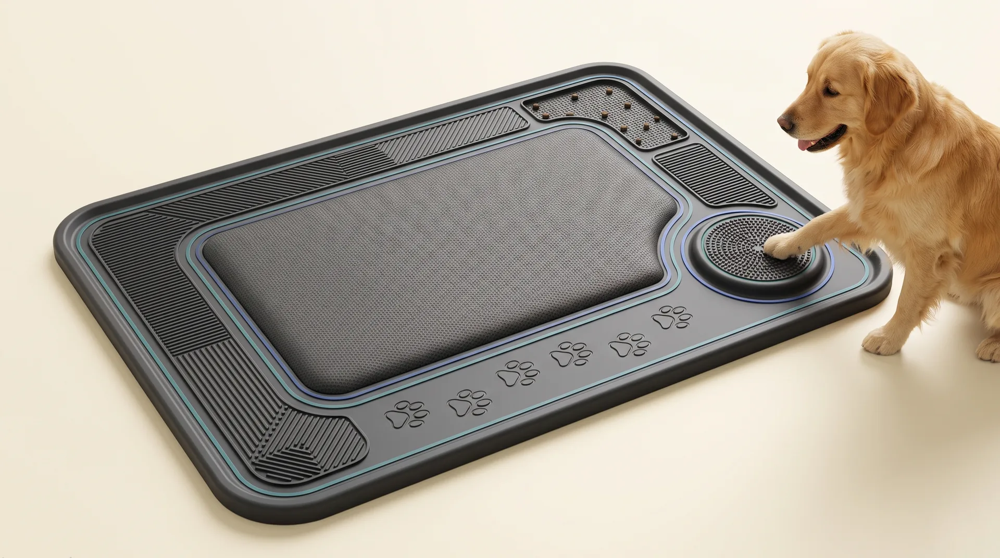
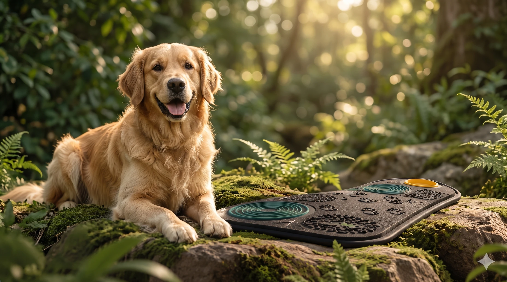

# PAWPATH

> *Good dogs aren't born. They learn.*

A modern, editorial ecommerce experience built for **PAWPATH** — an innovative pet-care brand introducing an all-in-one interactive dog-training mat.



---

## Overview

**PAWPATH** is a physical, owner-guided training aid designed to turn everyday obedience, patience, and manners training into engaging little challenges. Rather than an autonomous electronic trainer, it provides a structured, tactile learning space that bridges joyful playtime with positive reinforcement.

The single-piece mat features five permanently integrated training zones:

| Zone | Focus Area | Canine Skill Reinforcement | Handler Cue |
| :--- | :--- | :--- | :--- |
| **01. The Target Zone** | Precision & Focus | Nose touches, paw targeting, directional orientation | *"Touch!" / "Paw!"* |
| **02. The Place Zone** | Boundary Calm | Settle, down-stay, doorbell patience, calm boundary manners | *"Place!" / "Settle!"* |
| **03. The Wait Zone** | Impulse Control | Threshold pause, duration holds, calm patience before release | *"Wait..." ➔ "Free!"* |
| **04. The Pathway Zone** | Recall & Direction | Recall runway, loose-leash alignment, guided pawstep routes | *"Here!" / "Follow!"* |
| **05. The Reward Zone** | Positive Reinforcement | Positive dock, gentle taking, high-value dopamine association | *"Yes!" / Reward* |

---

## The Mat & Flagship Design



Built with heavy-duty, food-grade silicone and natural vulcanized rubber, PAWPATH requires **no batteries, wires, or electricity**. It lays completely flat on hardwood, tile, and rugs with an anti-curl beveled perimeter and an ultra-grip non-slip base.

---

## Key Features & User Experience

- **Immersive Multi-Slide Hero**: Dynamic slide-bar controls, smooth chapter transitions, and quick-scroll triggers.
- **60-Second Video Walkthrough Modal**: Interactive modal with sound toggling and direct one-click chapter navigation to any zone.
- **Desktop Scroll-Locked 5-Zone Runway**: Center-viewport sticky locking below the navbar that dynamically advances through all 5 zones as the user scrolls, unlocking cleanly once the tour finishes.
- **Mobile-Optimized Vertical Stack**: Mobile view seamlessly un-locks into a clean vertical stack with zero clipping and full touch responsiveness.
- **Scroll-Triggered Creative Animations**: Custom reveal transitions (`.reveal-on-scroll`, `.scale-on-scroll`, `.reveal-from-left`, `.reveal-from-right`) with staggered card reveals.
- **Full-Page Mobile Menu**: Warm ivory overlay with animated navigation links, brand badges, and smooth entrance transitions.
- **Zero URL Hash Fragments**: Clean, smooth in-page scrolling (`scrollToElement`) that prevents hash anchors (`#faq`, `#experience`) from polluting the browser URL.
- **Accordion FAQ Section**: Pure CSS grid height transition (`grid-rows-[0fr]` to `grid-rows-[1fr]`) with rotating chevrons answering questions about puppy training, materials, safety, and shipping.
- **Minimal Brand Preloader & Favicon**: Deep green and ivory SVG pawprint favicon (`/icon.svg`) and animated preloader.

---

## Final Brand Vision



> *"Every pawstep counts. Make room for more than playtime. Make room for progress, little victories, and a whole lot of tail wags."*

---

## Pages & Routes

The store is structured around an editorial narrative rather than generic commerce templates:

- **`/` — Homepage**  
  Immersive hero with interactive zone preview cards, brand philosophy with lifestyle photography, flagship 3D mat reveal, 5-zone scroll-locked showcase, 3-stage learning journey (*The Beginner, The Learner, The Well-Mannered*), 4-step training methodology (*Choose, Give cue, Reward, Repeat*), 4 key product design pillars, accordion FAQ section, and closing brand statement.

- **`/product/pawpath` — Dedicated Product Launch Page**  
  Asymmetrical media gallery with 7 zone views, thumbnail switcher, zoom modal lightbox, technical specification matrix, interactive zone explorer, and a floating sticky purchase bar.

- **`/checkout` — Validated Checkout**  
  Type-safe checkout powered by React Hook Form and Zod. Features full contact details, Indian postal address validation, shipping selector (Standard vs Express Courier), simulated sandbox payment (UPI, Card, COD), dynamic order recalculation, and a 1-click **Autofill Demo Details** testing card.

- **`/order-confirmation` — Order Confirmation**  
  Confirmed order summary, unique order reference code (`PAW-XXXXXX-IN`) with a 1-click clipboard copy component, estimated delivery calculation, itemized pricing breakdown, and next-step training guidance.

- **`POST /api/orders` — Orders REST API**  
  Server-side validation endpoint verifying line items, calculating dynamic shipping thresholds (Free shipping over ₹1,999), and minting unique order records.

---

## Design System

- **Art Direction:** Modern editorial print aesthetic — generous rounded containers (`rounded-[36px]`, `rounded-[48px]`), organic asymmetrical grids, and tactile pill tags.
- **Color Palette:**
  - **Deep Forest Green:** `#123321` (primary text, solid CTA buttons, dark containers)
  - **Sage & Botanical Green:** `#678a52` / `#9ec490` / `#3d6848` (accents, radar rings, highlights)
  - **Warm Ivory / Cream:** `#f7f5ee` (page background, subtle surface tints)
  - **Subtle Sage White:** `#e7ede4` / `#f0f4ee` (pill badges, card backgrounds)
  - *Zero yellow tones used.*
- **Typography:** *Plus Jakarta Sans* for bold editorial headlines, *Inter* for body copy, and serif italics for expressive accents.

---

## Project Structure

```
pawpath/
├── public/
│   ├── icon.svg                   # Brand pawprint SVG favicon
│   └── images/
│       └── products/              # Optimized WebP product and lifestyle assets
│           ├── herobg.webp        # Full hero background (Golden Retriever & mat)
│           ├── hero.webp          # Flagship mat 3D perspective render
│           ├── lifestyle.webp     # Living room in-home shot
│           ├── dog-lifestyle.webp # Brand philosophy editorial lifestyle photo
│           ├── lastbg.webp        # Final brand statement background
│           ├── stage-puppy.webp   # Training stage: Puppy / The Beginner
│           ├── stage-learner.webp # Training stage: Learner
│           ├── stage-adult.webp   # Training stage: Well-Mannered
│           ├── zone-target.webp   # Zone 01 close-up
│           ├── zone-place.webp    # Zone 02 close-up
│           ├── zone-wait.webp     # Zone 03 close-up
│           ├── zone-pathway.webp  # Zone 04 close-up
│           └── zone-reward.webp   # Zone 05 close-up
│
├── src/
│   ├── app/
│   │   ├── layout.tsx             # Root layout: metadata, icons, preloader, header & footer
│   │   ├── page.tsx               # Homepage — "/"
│   │   ├── globals.css            # Tailwind v4 theme, animations & reveal utilities
│   │   ├── icon.svg               # App router icon
│   │   ├── robots.ts              # robots.txt generator
│   │   ├── sitemap.ts             # sitemap.xml generator
│   │   │
│   │   ├── product/pawpath/       # Dedicated product launch route
│   │   │   ├── page.tsx
│   │   │   └── layout.tsx
│   │   │
│   │   ├── checkout/              # Checkout route
│   │   │   ├── page.tsx
│   │   │   └── layout.tsx
│   │   │
│   │   ├── order-confirmation/    # Order confirmation route
│   │   │   ├── page.tsx
│   │   │   └── copy-reference.tsx
│   │   │
│   │   └── api/orders/            # Orders API
│   │       └── route.ts
│   │
│   ├── components/                # Shared UI components
│   │   ├── header.tsx             # Header with full-page mobile menu & brand CTA
│   │   ├── footer.tsx             # Editorial forest-green footer with hash-free scroll
│   │   ├── loader.tsx             # Smooth brand preloader
│   │   ├── cart-drawer.tsx        # Persistent slide-out cart drawer
│   │   ├── polished-image.tsx     # Reusable image container with fallback
│   │   ├── zone-showcase.tsx      # Interactive zone tour with render previews
│   │   ├── zone-diagram.tsx       # Radial 5-zone mat layout diagram
│   │   └── ui/                    # Button & Card primitives
│   │
│   └── lib/                       # Centralized logic & configuration
│       ├── products.ts            # Product data, pricing (₹3,499), FAQs, specs
│       ├── cart.ts                # Reactive cart store (useSyncExternalStore)
│       ├── validations.ts         # Zod schemas for checkout & API
│       └── utils.ts               # cn(), formatINR(), generateOrderReference()
│
├── next.config.ts
├── package.json
└── tsconfig.json
```

---

## Getting Started

### Prerequisites
- Node.js 18+ (tested on Node v20/v23)
- npm 9+

### Installation
```bash
# Clone the repository
git clone <repository-url>
cd pawpath-cheat

# Install dependencies
npm install
```

### Development
```bash
npm run dev
```
Open [http://localhost:3000](http://localhost:3000) (or the port indicated by the terminal) in your browser.

### Production Build
```bash
# Type check and build optimized bundle
npm run build

# Start production server
npm run start
```

---

## Tech Stack

- **Framework:** Next.js 16 (App Router with Turbopack)
- **Language:** TypeScript 5
- **Styling:** Tailwind CSS v4
- **State Management:** `useSyncExternalStore` + `localStorage`
- **Forms & Validation:** React Hook Form + Zod
- **Animations:** CSS Keyframes & Transitions + Motion (Framer Motion)
- **Icons:** Lucide React
- **Image Optimization:** Modern WebP format with responsive Next.js `Image`

---

## License

© 2026 PAWPATH. All rights reserved.
